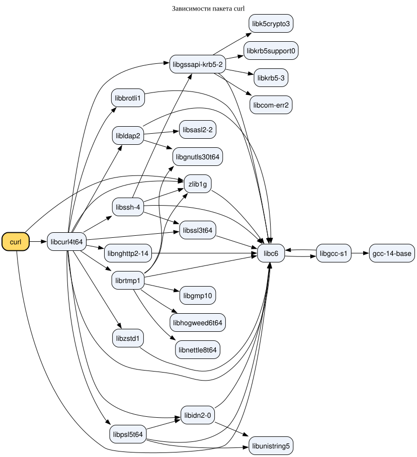
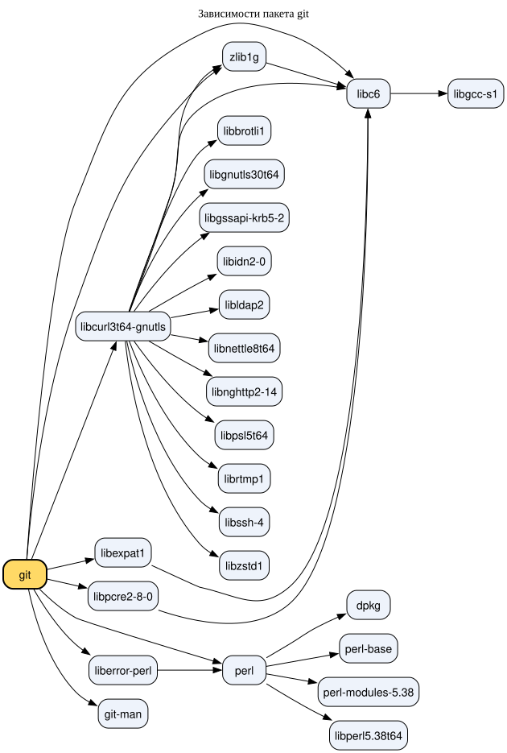
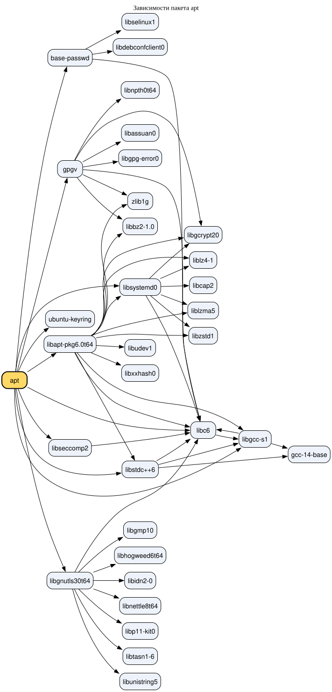

# dependency-graph-visualizer

Инструмент командной строки для визуализации графа зависимостей пакетов
Ubuntu (apt). Практическая работа №2 по дисциплине «Конфигурационное
управление», вариант 24.

Зависимости извлекаются напрямую из индексов репозитория, без использования
менеджеров пакетов и сторонних библиотек. Программа написана на Python 3 и
использует только стандартную библиотеку.

## Состояние работы

| Этап | Содержание                                   | Статус     |
|------|----------------------------------------------|------------|
| 1    | Минимальный прототип с конфигурацией (CSV)   | выполнен   |
| 2    | Сбор данных о прямых зависимостях            | выполнен   |
| 3    | Граф зависимостей (DFS без рекурсии)         | выполнен   |
| 4    | Обратные зависимости                         | выполнен   |
| 5    | Визуализация (Graphviz, SVG, ASCII-дерево)   | выполнен   |

## Структура репозитория

```
src/depgraph/        исходный код
  __main__.py        запуск через python -m depgraph
  cli.py             интерфейс командной строки
  config.py          загрузка и проверка конфигурации
  apt_repo.py        загрузка, кэширование и разбор индекса пакетов Ubuntu
  test_repo.py       чтение файла тестового репозитория
  graph.py           построение графа зависимостей (DFS без рекурсии)
  visualize.py       Graphviz DOT, SVG и ASCII-дерево
  errors.py          общие исключения
tests/               модульные тесты (unittest)
examples/configs/    примеры корректных конфигураций
examples/errors/     конфигурации для демонстрации обработки ошибок
examples/repos/      файлы тестовых репозиториев
examples/output/     примеры визуализации (DOT и SVG)
config.csv           конфигурация по умолчанию
run.sh, run.bat      скрипты запуска приложения и тестов
```

## Конфигурация

Параметры задаются в CSV-файле из двух столбцов `key,value`. Первая строка
`key,value` (заголовок), пустые строки и строки, начинающиеся с `#`,
пропускаются. Каждый параметр должен встречаться не более одного раза;
все параметры, кроме отмеченных как необязательные, обязательны.

| Ключ | Назначение | Допустимые значения |
|---|---|---|
| `package` | Имя анализируемого пакета | apt: `[a-z0-9][a-z0-9+.-]+`; тестовый режим: `[A-Z]+` |
| `repository` | URL репозитория или путь к тестовому файлу | URL зеркала или файла `Packages(.gz)`; путь к файлу |
| `test_mode` | Режим работы с тестовым репозиторием | `true/false`, `yes/no`, `1/0`, `on/off` |
| `output_image` | Имя файла с изображением графа | имя с расширением `.svg`, каталог должен существовать |
| `ascii_tree` | Вывод зависимостей в виде ASCII-дерева | `true/false`, `yes/no`, `1/0`, `on/off` |
| `max_depth` | Максимальная глубина анализа | целое число от 1 до 100 |
| `filter_substring` | Подстрока: пакеты с ней в имени пропускаются | любая строка; пустая — фильтр отключён |
| `component` | Компонент репозитория (необязательный) | `main` (по умолчанию), `restricted`, `universe`, `multiverse` |
| `reverse` | Режим обратных зависимостей (необязательный) | `true/false` и т. п., по умолчанию `false` |

Пример (`config.csv`):

```csv
key,value
package,curl
repository,http://archive.ubuntu.com/ubuntu
test_mode,false
output_image,graph.svg
ascii_tree,true
max_depth,3
filter_substring,
```

### Обработка ошибок конфигурации

Программа проверяет файл целиком и выводит сразу все найденные проблемы,
после чего завершается с кодом 2. Обнаруживаются:

* отсутствующий или нечитаемый файл конфигурации;
* строка с числом столбцов, отличным от двух;
* неизвестный, повторяющийся или отсутствующий обязательный параметр;
* `test_mode`, `ascii_tree`, `reverse` — не логическое значение;
* `max_depth` — не целое число или вне диапазона 1–100;
* `output_image` — пустое имя, расширение не `.svg`, недопустимые символы,
  несуществующий каталог;
* `package` — пустое имя или имя, не соответствующее режиму работы;
* `repository` — URL не по протоколу http/https либо без хоста; в тестовом
  режиме — отсутствующий файл;
* `component` — не один из компонентов Ubuntu;
* `filter_substring` — подстрока содержится в имени самого анализируемого
  пакета (тогда анализировать нечего).

Если значение `test_mode` неверно, параметры `package` и `repository`
не проверяются, поскольку правила их проверки зависят от режима.

## Источники данных

Оба источника дают данные в одном формате — словарь «пакет → список прямых
зависимостей», поэтому алгоритм построения графа от источника не зависит.

### Репозиторий Ubuntu

Программа загружает индекс пакетов (`Packages.gz`) по HTTP средствами
стандартной библиотеки (`urllib`), распаковывает его (`gzip`) и разбирает
вручную:

1. Индекс делится на записи, разделённые пустыми строками. Строки,
   начинающиеся с пробела, продолжают значение предыдущего поля.
2. Для каждой записи берутся поля `Package`, `Pre-Depends` и `Depends`.
3. Значения зависимостей делятся по запятым; в каждой группе берётся первая
   альтернатива, отбрасываются ограничения версий `(...)`, архитектур
   `[...]`, профилей `<...>` и квалификатор `:any`; повторы удаляются.
4. Из поля `Provides` собирается словарь «виртуальное имя → пакеты-
   поставщики» (версии в `Provides` отбрасываются). Если зависимости нет
   в индексе, но её предоставляет какой-либо пакет, она заменяется
   поставщиком; при нескольких поставщиках выбирается **первый по
   алфавиту**. Пакет, который есть в индексе, не заменяется. Например,
   `libssh-4` зависит от виртуального `libssl3`, который предоставляет
   `libssl3t64`, — в граф попадает `libssl3t64`.

URL индекса: `<repository>/dists/noble/<component>/binary-amd64/Packages.gz`.
Если `repository` оканчивается на `/Packages` или `/Packages.gz`, адрес
используется как есть.

**Кэш.** Загруженный индекс сохраняется в каталоге `cache/` (исключён из
репозитория) под именем, полученным из URL, и при следующих запусках
берётся оттуда без обращения к сети. Чтобы загрузить индекс заново,
удалите соответствующий файл из `cache/`.

### Тестовый репозиторий

При `test_mode=true` параметр `repository` — путь к текстовому файлу
(UTF-8), где по одному пакету на строку записано `ИМЯ: ЗАВИСИМОСТЬ ...`.
Имена — заглавные латинские буквы. Строка `ИМЯ:` описывает пакет без
зависимостей; пакеты, упомянутые только как зависимости, тоже считаются
пакетами без зависимостей. Пустые строки и строки, начинающиеся с `#`,
пропускаются. Ошибки формата (нет двоеточия, недопустимое имя, повторное
описание пакета) выводятся с номерами строк.

```
# Цикл: A -> B -> C -> A, у C есть ещё зависимость D
A: B
B: C
C: A D
D:
```

## Построение графа

Граф строится обходом в глубину **без рекурсии** — с явным стеком пар
(пакет, глубина):

1. В стек кладётся стартовый пакет с глубиной 0.
2. Из стека извлекается пакет. Если он извлечён с глубиной больше уже
   известной или находится на глубине `max_depth`, он не разворачивается.
3. Иначе для пакета записываются рёбра ко всем его зависимостям, кроме
   исключённых фильтром. Зависимость кладётся в стек, только если до неё
   найден путь короче известного (или она встречена впервые).

Свойства алгоритма:

* **Глубина** пакета — длина кратчайшего пути от стартового пакета. Если
  пакет сначала найден длинным путём, а затем коротким, он разворачивается
  заново, и его зависимости тоже получают меньшую глубину. Пакеты на
  глубине `max_depth` попадают в граф, но их зависимости не анализируются.
* **Фильтр.** Пакет, имя которого содержит `filter_substring`, не попадает
  в граф, и его зависимости через него не обходятся.
* **Циклы.** Ребро на уже посещённый пакет сохраняется (цикл виден в
  выводе), но пакет повторно в стек не кладётся, поэтому обход завершается.
  Петля `A -> A` обрабатывается так же.
* Зависимости, отсутствующие в репозитории (например, пакеты другого
  компонента или виртуальные пакеты без поставщика), включаются в граф
  как листья и перечисляются отдельно.

Вывод на этапе 3 — список рёбер `A -> B`, число пакетов и глубина каждого
пакета; начиная с этапа 5 граф выводится визуально (см. «Визуализация»).

## Обратные зависимости

При `reverse=true` выводятся пакеты, которые зависят от заданного пакета
(прямо или транзитивно). Обратный граф строится разворотом всех рёбер
репозитория: из словаря «пакет → зависимости» получается словарь
«пакет → пакеты, которые от него зависят». По нему выполняется **тот же
обход** `build_graph`, что и на этапе 3, поэтому действуют ограничение
глубины, фильтр и обработка циклов.

На этапе 4 обратные зависимости выводились списком рёбер `A <- B`
(«B зависит от A»). Начиная с этапа 5 этот вывод заменён визуализацией:
при `reverse=true` в DOT/SVG и ASCII-дерево попадает граф зависящих
пакетов, стрелки на рисунке по-прежнему ведут от пакета к его зависимости.

## Визуализация

1. **Graphviz DOT.** Граф описывается на языке DOT (`digraph`, по одному
   ребру `"пакет" -> "зависимость"` на строку). Стартовый пакет выделен
   цветом и толстой рамкой, отсутствующие в репозитории пакеты нарисованы
   пунктиром. Описание сохраняется рядом с изображением: для
   `output_image=examples/output/curl.svg` — в `examples/output/curl.dot`.
2. **SVG.** Изображение получается вызовом утилиты `dot` из пакета
   Graphviz: `dot -Tsvg <файл.dot> -o <output_image>` (через `subprocess`).
   Если `dot` не найден в `PATH`, программа сообщает об этом с подсказкой
   установить Graphviz и завершается с кодом 4; DOT-файл при этом уже
   сохранён. Длинные строки SVG (координаты линий) после `dot` переносятся
   по пробелам — в XML это равнозначно пробелу, изображение не меняется.
3. **ASCII-дерево** выводится при `ascii_tree=true` (символы `├── └── │`).
   Каждый пакет раскрывается один раз — там, где его уровень в дереве
   равен длине кратчайшего пути до него, поэтому дерево не глубже
   `max_depth`. Остальные вхождения пакета помечаются `(*)` и не
   раскрываются; так же обрабатываются циклы. Дерево строится без
   рекурсии.

Перед деревом выводится сводка: число пакетов и рёбер, отсутствующие в
репозитории пакеты.

## Принятые решения

Задание оставляет часть деталей на усмотрение исполнителя:

* **Репозиторий Ubuntu.** Релиз `noble` (Ubuntu 24.04 LTS), архитектура
  `amd64`, компонент задаётся параметром `component` (по умолчанию `main`).
  Анализируется один компонент: зависимости из других компонентов
  считаются отсутствующими.
* **Разбор зависимостей.** Учитываются поля `Pre-Depends` и `Depends`:
  оба задают обязательные зависимости (например, у `tar` все зависимости
  записаны в `Pre-Depends`). Поля `Recommends`, `Suggests` и прочие не
  учитываются. Ограничения версий (`(>= 2.34)`) и квалификаторы
  архитектуры (`:any`) отбрасываются. Из альтернатив `a | b` берётся
  первая — её apt выбирает по умолчанию.
* **Виртуальные пакеты** разрешаются через поле `Provides` того же
  индекса; из нескольких поставщиков берётся первый по алфавиту.
* **Формат тестового репозитория** — см. раздел «Тестовый репозиторий».
* **Глубина** — число рёбер от стартового пакета: при `max_depth=1`
  анализируются только прямые зависимости. Ограничена диапазоном 1–100.

## Коды завершения

| Код | Значение |
|---|---|
| 0 | успешное выполнение |
| 2 | ошибка конфигурации |
| 3 | ошибка репозитория: индекс не загружен, файл тестового репозитория неверен или пакет не найден |
| 4 | ошибка визуализации: не найден или завершился с ошибкой `dot` |

## Запуск

Требуется Python 3.8 или новее; сборка не требуется. Для получения
SVG нужна утилита `dot` из [Graphviz](https://graphviz.org/download/)
(Windows: установщик с сайта или `winget install graphviz`, затем добавить
`C:\Program Files\Graphviz\bin` в `PATH`; Ubuntu: `sudo apt install graphviz`).
Без Graphviz программа выводит ASCII-дерево и сохраняет DOT-файл.

```sh
./run.sh                      # конфигурация config.csv
./run.sh examples/configs/test_cycle.csv
./run.sh test                 # тесты
```

В Windows:

```bat
run.bat
run.bat examples\configs\test_cycle.csv
run.bat test
```

Без скриптов:

```sh
PYTHONPATH=src python -m depgraph config.csv
PYTHONPATH=src python -m unittest discover -s tests -v
```

Проверка оформления кода (инструменты устанавливаются отдельно,
`pip install flake8 radon`):

```sh
python -m flake8 --max-line-length=80 src tests
python -m radon cc -s src
```

## Примеры использования

### Тестовый репозиторий

| Конфигурация | Репозиторий | Что демонстрирует |
|---|---|---|
| `test_chain.csv` | `chain.txt` | транзитивные зависимости цепочки A→B→C→D→E |
| `test_depth_limit.csv` | `chain.txt` | ограничение глубины (`max_depth=2`) |
| `test_diamond.csv` | `diamond.txt` | общая зависимость D входит в граф один раз |
| `test_cycle.csv` | `cycle.txt` | цикл A→B→C→A |
| `test_self_loop.csv` | `self_loop.txt` | петля A→A |
| `test_shortcut.csv` | `shortcut.txt` | пакет на путях длины 1 и 3, глубина по кратчайшему |
| `test_filter.csv` | `filter.txt` | исключение пакетов с подстрокой `DEV` |
| `test_no_filter.csv` | `filter.txt` | тот же граф без фильтра |
| `test_reverse_none.csv` | `chain.txt` | обратные зависимости: от A никто не зависит |
| `test_reverse_many.csv` | `filter.txt` | от CORE зависят многие пакеты |
| `test_reverse_diamond.csv` | `diamond.txt` | от E зависят все пакеты ромба |
| `test_reverse_cycle.csv` | `cycle.txt` | обратный обход цикла |
| `test_reverse_depth.csv` | `chain.txt` | обратные зависимости с `max_depth=2` |
| `test_reverse_filter.csv` | `filter.txt` | обратные зависимости с фильтром `DEV` |
| `errors/test_missing_package.csv` | `chain.txt` | несуществующий стартовый пакет |
| `errors/test_broken_repo.csv` | `broken.txt` | ошибки формата файла |

Цикл и петля — повторно встреченный пакет помечен `(*)`:

```
$ ./run.sh examples/configs/test_cycle.csv
Тестовый репозиторий: examples/repos/cycle.txt
Зависимости пакета A (максимальная глубина 10): пакетов 4, рёбер 4

A
└── B
    └── C
        ├── A (*)
        └── D

Описание графа (Graphviz DOT): graph.dot
Изображение графа (SVG): graph.svg

$ ./run.sh examples/configs/test_self_loop.csv
Тестовый репозиторий: examples/repos/self_loop.txt
Зависимости пакета A (максимальная глубина 5): пакетов 3, рёбер 3

A
├── A (*)
└── B
    └── C

Описание графа (Graphviz DOT): graph.dot
Изображение графа (SVG): graph.svg
```

Пакет X достижим путями `A -> X` и `A -> B -> C -> X`. Обход сначала приходит
в X длинным путём, затем коротким и разворачивает X заново, поэтому Y и Z
попадают в граф; в дереве X раскрыт на кратчайшем пути:

```
$ ./run.sh examples/configs/test_shortcut.csv
Тестовый репозиторий: examples/repos/shortcut.txt
Зависимости пакета A (максимальная глубина 3): пакетов 6, рёбер 6

A
├── B
│   └── C
│       └── X (*)
└── X
    └── Y
        └── Z

Описание графа (Graphviz DOT): graph.dot
Изображение графа (SVG): graph.svg
```

Фильтр `DEV`: `LIBDEV` и `DEVKIT` исключены, `HEADERS` достижим только
через `LIBDEV` и поэтому тоже не попал в граф:

```
$ ./run.sh examples/configs/test_no_filter.csv
Тестовый репозиторий: examples/repos/filter.txt
Зависимости пакета APP (максимальная глубина 5): пакетов 7, рёбер 9

APP
├── LIB
│   └── CORE
├── LIBDEV
│   ├── LIB (*)
│   └── HEADERS
└── TOOLS
    ├── DEVKIT
    │   └── CORE (*)
    └── CORE (*)

Описание графа (Graphviz DOT): graph.dot
Изображение графа (SVG): graph.svg

$ ./run.sh examples/configs/test_filter.csv
Тестовый репозиторий: examples/repos/filter.txt
Зависимости пакета APP (максимальная глубина 5, исключаются пакеты с «DEV»): пакетов 4, рёбер 4

APP
├── LIB
│   └── CORE
└── TOOLS
    └── CORE (*)

Описание графа (Graphviz DOT): graph.dot
Изображение графа (SVG): graph.svg
```

Ограничение глубины:

```
$ ./run.sh examples/configs/test_depth_limit.csv
Тестовый репозиторий: examples/repos/chain.txt
Зависимости пакета A (максимальная глубина 2): пакетов 3, рёбер 2

A
└── B
    └── C

Описание графа (Graphviz DOT): graph.dot
Изображение графа (SVG): graph.svg
```

Обратные зависимости (этап 4):

```
$ ./run.sh examples/configs/test_reverse_many.csv
Тестовый репозиторий: examples/repos/filter.txt
Обратные зависимости пакета CORE (максимальная глубина 10): пакетов 6, рёбер 8

CORE
├── LIB
│   ├── APP
│   └── LIBDEV
│       └── APP (*)
├── TOOLS
│   └── APP (*)
└── DEVKIT
    └── TOOLS (*)

Описание графа (Graphviz DOT): graph.dot
Изображение графа (SVG): graph.svg

$ ./run.sh examples/configs/test_reverse_cycle.csv
Тестовый репозиторий: examples/repos/cycle.txt
Обратные зависимости пакета A (максимальная глубина 10): пакетов 3, рёбер 3

A
└── C
    └── B
        └── A (*)

Описание графа (Graphviz DOT): graph.dot
Изображение графа (SVG): graph.svg

$ ./run.sh examples/configs/test_reverse_none.csv
Тестовый репозиторий: examples/repos/chain.txt
Обратные зависимости пакета A (максимальная глубина 10): пакетов 1, рёбер 0

A

Описание графа (Graphviz DOT): graph.dot
Изображение графа (SVG): graph.svg
```

Ошибки:

```
$ ./run.sh examples/errors/test_missing_package.csv
Тестовый репозиторий: examples/repos/chain.txt
Ошибка репозитория:
  - пакет «Q» не найден в репозитории

$ ./run.sh examples/errors/test_broken_repo.csv
Тестовый репозиторий: examples/repos/broken.txt
Ошибка репозитория:
  - ошибки в файле examples/repos/broken.txt:
    строка 3: ожидается строка вида «ИМЯ: ЗАВИСИМОСТИ»
    строка 4: недопустимое имя пакета «c»
```

### Репозиторий Ubuntu

Компонент `universe`: `perl` и `libtext-charwidth-perl` находятся в `main`,
поэтому в индексе `universe` их нет:

```
$ ./run.sh examples/configs/universe.csv
Индекс пакетов: http://archive.ubuntu.com/ubuntu/dists/noble/universe/binary-amd64/Packages.gz
Зависимости пакета cowsay (максимальная глубина 3): пакетов 3, рёбер 2
Нет в репозитории (зависимости неизвестны): libtext-charwidth-perl, perl
Описание графа (Graphviz DOT): graph.dot
Изображение графа (SVG): graph.svg
```

Обратные зависимости реального пакета:

```
$ ./run.sh examples/configs/reverse_liberror.csv
Индекс пакетов: http://archive.ubuntu.com/ubuntu/dists/noble/main/binary-amd64/Packages.gz
Обратные зависимости пакета liberror-perl (максимальная глубина 2): пакетов 11, рёбер 10
Описание графа (Graphviz DOT): graph.dot
Изображение графа (SVG): graph.svg
```

Другие примеры: `config.csv`, `curl_filter.csv` (curl без пакетов с `krb5`),
`git.csv`, `apt.csv`, `tar.csv`, `bash-completion.csv`; ошибки — `examples/errors/`.

## Примеры визуализации

Три реальных пакета из `noble/main` (конфигурации `examples/configs/viz_*.csv`):

| Пакет | Глубина | Пакетов | Рёбер | DOT | SVG |
|---|---|---|---|---|---|
| `curl` | 3 | 26 | 46 | [curl.dot](examples/output/curl.dot) | [curl.svg](examples/output/curl.svg) |
| `git` | 2 | 25 | 30 | [git.dot](examples/output/git.dot) | [git.svg](examples/output/git.svg) |
| `apt` | 2 | 33 | 53 | [apt.dot](examples/output/apt.dot) | [apt.svg](examples/output/apt.svg) |

Стартовый пакет выделен жёлтым, пакеты, отсутствующие в индексе, — пунктиром.

### curl



<details>
<summary>Вывод программы и ASCII-дерево</summary>

```
$ ./run.sh examples/configs/viz_curl.csv
Индекс пакетов: http://archive.ubuntu.com/ubuntu/dists/noble/main/binary-amd64/Packages.gz
Зависимости пакета curl (максимальная глубина 3): пакетов 26, рёбер 46

curl
├── libc6
│   └── libgcc-s1
│       ├── gcc-14-base
│       └── libc6 (*)
├── libcurl4t64
│   ├── libbrotli1
│   │   └── libc6 (*)
│   ├── libc6 (*)
│   ├── libgssapi-krb5-2
│   │   ├── libkrb5-3
│   │   ├── libc6 (*)
│   │   ├── libcom-err2
│   │   ├── libk5crypto3
│   │   └── libkrb5support0
│   ├── libidn2-0
│   │   ├── libc6 (*)
│   │   └── libunistring5
│   ├── libldap2
│   │   ├── libc6 (*)
│   │   ├── libgnutls30t64
│   │   └── libsasl2-2
│   ├── libnghttp2-14
│   │   └── libc6 (*)
│   ├── libpsl5t64
│   │   ├── libidn2-0 (*)
│   │   ├── libc6 (*)
│   │   └── libunistring5 (*)
│   ├── librtmp1
│   │   ├── libc6 (*)
│   │   ├── libgmp10
│   │   ├── libgnutls30t64 (*)
│   │   ├── libhogweed6t64
│   │   ├── libnettle8t64
│   │   └── zlib1g (*)
│   ├── libssh-4
│   │   ├── libc6 (*)
│   │   ├── libgssapi-krb5-2 (*)
│   │   ├── libssl3t64 (*)
│   │   └── zlib1g (*)
│   ├── libssl3t64
│   │   └── libc6 (*)
│   ├── libzstd1
│   │   └── libc6 (*)
│   └── zlib1g (*)
└── zlib1g
    └── libc6 (*)

Описание графа (Graphviz DOT): examples/output/curl.dot
Изображение графа (SVG): examples/output/curl.svg
```

</details>

### git



<details>
<summary>Вывод программы и ASCII-дерево</summary>

```
$ ./run.sh examples/configs/viz_git.csv
Индекс пакетов: http://archive.ubuntu.com/ubuntu/dists/noble/main/binary-amd64/Packages.gz
Зависимости пакета git (максимальная глубина 2): пакетов 25, рёбер 30

git
├── libc6
│   └── libgcc-s1
├── libcurl3t64-gnutls
│   ├── libbrotli1
│   ├── libc6 (*)
│   ├── libgnutls30t64
│   ├── libgssapi-krb5-2
│   ├── libidn2-0
│   ├── libldap2
│   ├── libnettle8t64
│   ├── libnghttp2-14
│   ├── libpsl5t64
│   ├── librtmp1
│   ├── libssh-4
│   ├── libzstd1
│   └── zlib1g (*)
├── libexpat1
│   └── libc6 (*)
├── libpcre2-8-0
│   └── libc6 (*)
├── zlib1g
│   └── libc6 (*)
├── perl
│   ├── dpkg
│   ├── perl-base
│   ├── perl-modules-5.38
│   └── libperl5.38t64
├── liberror-perl
│   └── perl (*)
└── git-man

Описание графа (Graphviz DOT): examples/output/git.dot
Изображение графа (SVG): examples/output/git.svg
```

</details>

### apt



<details>
<summary>Вывод программы и ASCII-дерево</summary>

```
$ ./run.sh examples/configs/viz_apt.csv
Индекс пакетов: http://archive.ubuntu.com/ubuntu/dists/noble/main/binary-amd64/Packages.gz
Зависимости пакета apt (максимальная глубина 2): пакетов 33, рёбер 53

apt
├── base-passwd
│   ├── libc6 (*)
│   ├── libdebconfclient0
│   └── libselinux1
├── gpgv
│   ├── libassuan0
│   ├── libbz2-1.0
│   ├── libc6 (*)
│   ├── libgcrypt20
│   ├── libgpg-error0
│   ├── libnpth0t64
│   └── zlib1g
├── libapt-pkg6.0t64
│   ├── libbz2-1.0 (*)
│   ├── libc6 (*)
│   ├── libgcc-s1 (*)
│   ├── libgcrypt20 (*)
│   ├── liblz4-1
│   ├── liblzma5
│   ├── libstdc++6 (*)
│   ├── libsystemd0 (*)
│   ├── libudev1
│   ├── libxxhash0
│   ├── libzstd1
│   └── zlib1g (*)
├── ubuntu-keyring
├── libc6
│   └── libgcc-s1 (*)
├── libgcc-s1
│   ├── gcc-14-base
│   └── libc6 (*)
├── libgnutls30t64
│   ├── libc6 (*)
│   ├── libgmp10
│   ├── libhogweed6t64
│   ├── libidn2-0
│   ├── libnettle8t64
│   ├── libp11-kit0
│   ├── libtasn1-6
│   └── libunistring5
├── libseccomp2
│   └── libc6 (*)
├── libstdc++6
│   ├── gcc-14-base (*)
│   ├── libc6 (*)
│   └── libgcc-s1 (*)
└── libsystemd0
    ├── libc6 (*)
    ├── libcap2
    ├── libgcrypt20 (*)
    ├── liblz4-1 (*)
    ├── liblzma5 (*)
    └── libzstd1 (*)

Описание графа (Graphviz DOT): examples/output/apt.dot
Изображение графа (SVG): examples/output/apt.svg
```

</details>

## Сравнение с apt

Штатные инструменты Ubuntu для просмотра зависимостей — `apt-cache depends`
(прямые зависимости), `apt-cache depends --recurse` (транзитивные),
`apt-cache rdepends` (обратные) и `debtree` (граф в формате DOT).

### Команды для проверки

На Ubuntu 24.04 (в Windows — например, в WSL: `wsl --install -d Ubuntu-24.04`):

```sh
apt-cache depends curl
apt-cache depends git
apt-cache depends apt
apt-cache depends --recurse --no-recommends --no-suggests --no-conflicts \
    --no-breaks --no-replaces --no-enhances curl
apt-cache rdepends liberror-perl
sudo apt install debtree graphviz
debtree curl | dot -Tsvg -o curl-debtree.svg
```

### Расхождения и их причины

Сравнение выполнено по данным индекса `Packages` (поля `Depends`,
`Recommends`, `Suggests`, `Provides` и др.), без запуска apt. Записи индекса `noble/main` для этих пакетов (версии из релиза, без
обновлений):

* `curl` 8.5.0-2ubuntu10 — `Depends: libc6 (>= 2.34), libcurl4t64 (= 8.5.0-2ubuntu10), zlib1g (>= 1:1.1.4)`;
* `git` 1:2.43.0-1ubuntu7 — кроме `Depends` есть `Recommends: ca-certificates,
  patch, less, ssh-client`, `Suggests: ...`, `Breaks: ...`;
* `apt` 2.7.14build2 — `Depends: base-passwd (>= 3.6.1) | adduser, gpgv, ...`,
  `Recommends: ca-certificates`, `Suggests: ...`, `Breaks`, `Conflicts`,
  `Replaces`.

1. **Альтернативы.** У `apt` нет `adduser`: из группы `base-passwd | adduser`
   берётся только первый вариант, а `apt-cache` показывает оба
   (`|Depends: base-passwd`, `Depends: adduser`).
2. **Recommends и Suggests.** У `git` нет `ca-certificates`, `less`, `patch`,
   `ssh-client`: учитываются только обязательные `Pre-Depends` и `Depends`,
   а `apt-cache depends` по умолчанию выводит и рекомендуемые, и
   предлагаемые пакеты.
3. **Breaks, Conflicts, Replaces.** У `apt` нет `Conflicts: apt-verify`: это
   не зависимости, а ограничения на совместную установку, но
   `apt-cache depends` их тоже выводит.
4. **Версии.** `libc6 (>= 2.34)` превращается в `libc6`. `apt-cache` версии
   тоже не выводит, а `debtree` подписывает их на рёбрах.
5. **Повторы.** В `Depends` пакета `git` пакет `git-man` указан дважды (две
   границы версии). Мы убираем повтор, `apt-cache` выводит обе записи.
6. **Виртуальные пакеты.** В графе `curl` зависимости `libssh-4` и
   `librtmp1` от `libssl3`, `libgnutls30`, `libnettle8`, `libhogweed6`
   показаны сразу как `libssl3t64`, `libgnutls30t64`, `libnettle8t64`,
   `libhogweed6t64`: это виртуальные имена, которые эти пакеты объявляют в
   `Provides` (переход на 64-битный `time_t`). `apt-cache depends`
   показывает виртуальное имя в угловых скобках (`<libssl3>`) и
   поставщиков строкой ниже. Если поставщиков несколько, мы берём первого
   по алфавиту, а apt выбирает с учётом приоритетов и уже установленных
   пакетов, поэтому выбор может различаться.
7. **Pre-Depends.** У `tar` зависимости `libacl1`, `libc6`, `libselinux1`
   записаны в `Pre-Depends`. Мы объединяем это поле с `Depends`, `apt-cache`
   выводит их отдельно как `PreDepends:`.
8. **Глубина и фильтр.** `curl` при `max_depth=3` — 26 пакетов;
   `apt-cache depends --recurse` обходит граф без ограничения глубины и
   без фильтра.
9. **Один компонент.** У `cowsay` из `universe` пакет `perl` отмечен как
   отсутствующий: анализируется индекс одного компонента, а apt видит все
   подключённые компоненты.
10. **Версия репозитория.** Используется индекс релиза `noble`; на
    установленной системе apt учитывает также `noble-updates` и
    `noble-security`, где версии и зависимости пакетов могут отличаться.
11. **Архитектура.** Анализируется только `amd64`; при включённом multiarch
    apt может показывать пакеты других архитектур.

На уровне прямых обязательных зависимостей (`Depends` с первой
альтернативой) результаты должны совпадать: для `curl` — `libc6`,
`libcurl4t64`, `zlib1g`.
